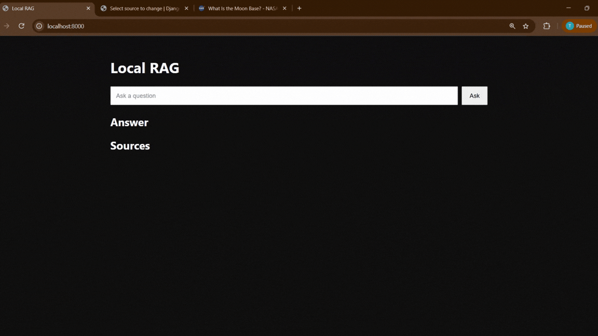
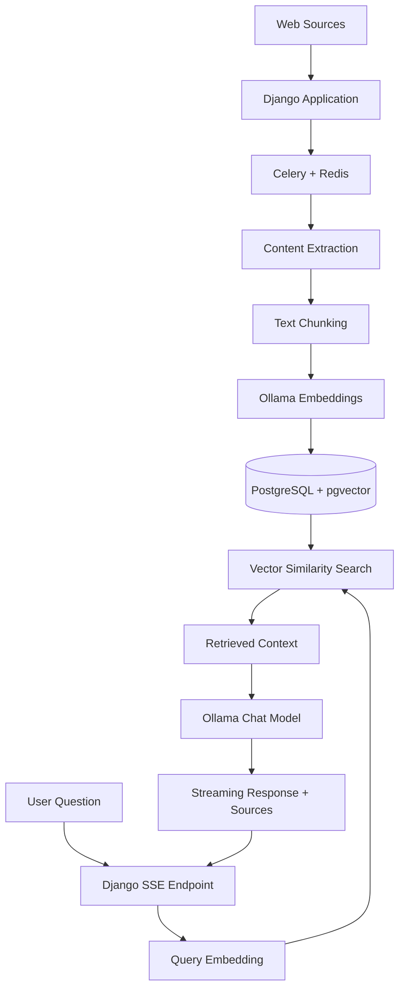

# Local Django RAG

A containerized, privacy-focused **Retrieval-Augmented Generation (RAG)** application built with **Django, PostgreSQL, pgvector, Celery, Redis, Docker Compose, and Ollama**. It provides document-grounded question answering by indexing web pages, generating local embeddings, retrieving relevant content through vector similarity search, and streaming AI-generated responses using Server-Sent Events (SSE).

The application runs its LLM inference and embedding generation locally through Ollama, eliminating dependencies on hosted AI APIs.

## Demo

Watch the application demonstration to see document ingestion, semantic retrieval, and real-time AI response streaming in action.

<!-- Replace with your actual YouTube video ID -->


## Features

- **Document Ingestion:** Extracts readable content from HTTP(S) pages and splits it into overlapping text chunks.
- **Semantic Search:** Uses PostgreSQL and pgvector for cosine-similarity retrieval.
- **Local LLM Integration:** Uses Ollama for embedding generation and AI response generation.
- **Asynchronous Processing:** Uses Celery and Redis for background document ingestion.
- **Real-Time Streaming:** Delivers incremental AI responses through Server-Sent Events.
- **Incremental Indexing:** Uses SHA-256 hashing to detect document changes and avoid unnecessary processing.
- **Embedding Reuse:** Reuses existing chunk embeddings when possible.
- **Data Consistency:** Performs atomic chunk replacement and cascading document deletion.
- **Source Attribution:** Associates generated responses with their retrieved source pages.

## Technology Stack

| Component | Technology |
|---|---|
| Backend | Python, Django 5 |
| Database | PostgreSQL 16 |
| Vector Search | pgvector |
| LLM Runtime | Ollama |
| Chat Model | DeepSeek-R1 |
| Embedding Model | EmbeddingGemma 2 |
| Background Tasks | Celery |
| Message Broker | Redis |
| Application Server | Daphne / ASGI |
| Streaming | Server-Sent Events |
| Infrastructure | Docker, Docker Compose |

## Architecture



### Processing workflow

1. Register an HTTP(S) source through Django Admin.
2. Django schedules asynchronous ingestion through Celery.
3. The application extracts, cleans, and chunks webpage content.
4. Ollama generates embeddings for new document chunks.
5. PostgreSQL stores the document metadata and vector representations.
6. Users submit questions through the chat interface.
7. The application retrieves relevant chunks using cosine similarity.
8. Ollama generates a context-grounded response, streamed through SSE with source attribution.

## Getting Started

### Prerequisites

- Docker Desktop or Docker Engine with Docker Compose.
- Git.

### 1. Clone the repository

```bash
git clone https://github.com/<your-account>/<your-repository>.git
cd <your-repository>
```

### 2. Configure environment variables

**Windows PowerShell**

```powershell
Copy-Item .env.example .env
```

**Linux / macOS**

```bash
cp .env.example .env
```

Review `.env` and configure your database credentials and application settings.

### 3. Start the application

```bash
docker compose up -d --build
```

Check the services:

```bash
docker compose ps
```

### 4. Initialize Django

```bash
docker compose exec web python manage.py migrate
docker compose exec web python manage.py createsuperuser
```

### 5. Download the Ollama models

The following commands match the default `.env.example` configuration:

```bash
docker compose exec ollama ollama pull deepseek-r1
docker compose exec ollama ollama pull embeddinggemma-2:latest
```

### 6. Access the application

| Interface | URL |
|---|---|
| Chat | http://127.0.0.1:8000/ |
| Django Admin | http://127.0.0.1:8000/admin/ |

Log in to Django Admin, register an enabled HTTP(S) source, and let Celery process its content. Once indexed, the source becomes available for question answering.

## Configuration

The application uses `.env.example` as its environment configuration template.

| Variable | Purpose |
|---|---|
| `DJANGO_SECRET_KEY` | Django cryptographic secret |
| `DJANGO_DEBUG` | Debug mode |
| `DJANGO_ALLOWED_HOSTS` | Allowed application hosts |
| `POSTGRES_DB` | Database name |
| `POSTGRES_USER` | Database username |
| `POSTGRES_PASSWORD` | Database password |
| `POSTGRES_HOST` | PostgreSQL hostname |
| `POSTGRES_PORT` | PostgreSQL port |
| `OLLAMA_BASE_URL` | Ollama API endpoint |
| `OLLAMA_CHAT_MODEL` | Generative model |
| `OLLAMA_EMBED_MODEL` | Embedding model |
| `OLLAMA_CHAT_MODEL_TEMPERATURE` | Generation temperature |
| `OLLAMA_CHAT_MODEL_CTX_WINDOW` | Model context window |
| `OLLAMA_CHAT_MODEL_OUTPUT_LENGTH` | Maximum generated tokens |
| `CELERY_BROKER_URL` | Redis broker |
| `CELERY_RESULT_BACKEND` | Redis result backend |
| `EMBEDDING_DIMENSIONS` | Expected vector dimensions |
| `RAG_CHUNK_SIZE` | Chunk size in characters |
| `RAG_CHUNK_OVERLAP` | Chunk overlap |
| `RAG_TOP_K` | Number of retrieved chunks |

**Embedding compatibility:** The default `embeddinggemma-2:latest` configuration expects 768-dimensional vectors. Changing the embedding model or dimensions requires corresponding database and indexing changes.

## Development and Testing

Run the Django test suite:

```bash
docker compose exec web python manage.py test
```

Run system checks:

```bash
docker compose exec web python manage.py check
```

Check for missing migrations:

```bash
docker compose exec web python manage.py makemigrations --check --dry-run
```

Manually trigger document ingestion:

```bash
docker compose exec web python manage.py ingest_sources
```

## Project Structure

```text
ragsite/
├── settings.py
├── urls.py
├── asgi.py
└── celery.py

ragapp/
├── admin.py
├── models.py
├── ollama.py
├── services.py
├── signals.py
├── tasks.py
├── views.py
├── management/
│   └── commands/
└── templates/
    └── ragapp/

docker-compose.yml
Dockerfile
requirements.txt
.env.example
manage.py
```

## Engineering Highlights

- Modular Django backend architecture.
- Asynchronous processing with Celery and Redis.
- Vector database integration with PostgreSQL and pgvector.
- Local LLM and embedding model integration through Ollama.
- Incremental indexing and content-hash-based change detection.
- Transactional document updates and embedding reuse.
- Real-time response streaming using SSE.
- Containerized development infrastructure using Docker Compose.

## License

This project is licensed under the MIT License. See [LICENSE](LICENSE) for details.

---

**Focus:** Backend Engineering, Applied AI, Retrieval-Augmented Generation, and Local LLM Infrastructure.